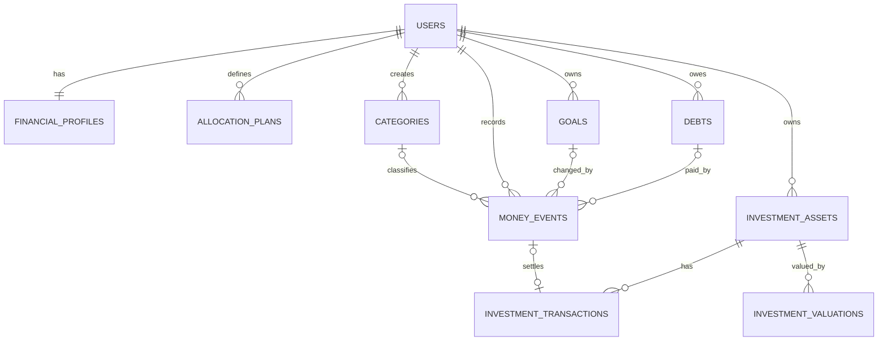

# Nisba Database Design V2

Status: approved working design for discussion. No production table is removed until V2 is implemented, migrated and verified.

## 1. Core rules

```text
Total Cash = SUM(money_events.cash_delta_cents)

Essentials Available = SUM(money_events.essentials_delta_cents)
Lifestyle Available = SUM(money_events.lifestyle_delta_cents)
Investments Available = SUM(money_events.investments_delta_cents)

Goal Balance = SUM(money_events.goal_delta_cents for that Goal)
Debt Remaining = starting balance + SUM(money_events.debt_delta_cents for that Debt)

Total Cash = Essentials + Lifestyle + Investments + all Goal balances
```

- Positive change means money increased.
- Negative change means money decreased.
- Zero cash change means existing money was moved internally.
- Debt payments belong to Essentials; Debt is not a fourth Track.
- Goals replace Wallets and the separate Emergency Fund balance.
- Unused money stays available automatically when the month changes.
- Actual income changes cash; expected income is only a plan.

## 2. Tables



### 2.1 `users`

Authentication identity and owner of all financial data.

| Column | Purpose |
|---|---|
| `id` | Primary key |
| `email` | Unique login email |
| `hashed_password` | Password hash |
| `created_at` | Account creation time |

### 2.2 `financial_profiles`

Permanent/default financial settings. It never stores real balances.

| Column | Purpose |
|---|---|
| `id` | Primary key |
| `user_id` | Unique FK to `users` |
| `currency` | Default `MAD` |
| `expected_monthly_income_cents` | Planning amount only |
| `onboarding_completed_at` | Null until setup is finished |
| `created_at`, `updated_at` | Audit times |

Actual income is added only after the user confirms receiving it.

### 2.3 `allocation_plans`

Keeps the history of how received income should be divided.

| Column | Purpose |
|---|---|
| `id` | Primary key |
| `user_id` | FK to `users` |
| `essentials_pct` | Essentials percentage |
| `lifestyle_pct` | Lifestyle percentage |
| `investments_pct` | Investments percentage |
| `effective_from` | Date this plan starts |
| `created_at` | Audit time |

Rules:

```text
Essentials % + Lifestyle % + Investments % = 100
UNIQUE(user_id, effective_from)
```

### 2.4 `categories`

Explains where money was spent. Nisba seeds defaults and users may create their own.

| Column | Purpose |
|---|---|
| `id` | Primary key |
| `user_id` | Null for defaults; user ID for custom Categories |
| `name` | Rent, Groceries, Travel, etc. |
| `track_kind` | `essentials`, `lifestyle` or `investments` |
| `is_system` | Default or user-created |
| `active` | Allows hiding without deleting history |

A Category connects directly to `money_events`. Its `track_kind` determines which Track change is normally used.

### 2.5 `money_events`

The central history for all cash, Track, Goal and Debt movements.

| Column | Purpose |
|---|---|
| `id` | Primary key |
| `user_id` | FK to `users` |
| `event_type` | Income, expense, reserve Goal, debt payment, etc. |
| `cash_delta_cents` | Change to Total Cash |
| `essentials_delta_cents` | Change to Essentials available money |
| `lifestyle_delta_cents` | Change to Lifestyle available money |
| `investments_delta_cents` | Change to Investments available money |
| `category_id` | Optional FK to `categories` |
| `goal_id` | Optional FK to `goals` |
| `goal_delta_cents` | Optional signed Goal change |
| `debt_id` | Optional FK to `debts` |
| `debt_delta_cents` | Optional signed Debt-principal change |
| `occurred_on` | Financial date |
| `note` | Optional explanation |
| `idempotency_key` | Prevents duplicate automatic/requested events |
| `reverses_event_id` | Optional self-FK for corrections |
| `created_at` | Database creation time |

Main event types:

```text
opening_balance
income
expense
goal_reserve
goal_release
goal_spend
track_transfer
debt_payment
investment_buy
investment_sell
investment_income
balance_adjustment
reversal
```

Every event must satisfy:

```text
cash_delta
= essentials_delta
+ lifestyle_delta
+ investments_delta
+ goal_delta
```

`debt_delta` is excluded because it changes a liability, not cash ownership.

Examples:

| Action | Cash | Essentials | Lifestyle | Investments | Goal | Debt |
|---|---:|---:|---:|---:|---:|---:|
| Receive 10,000 with 50/30/20 | +10,000 | +5,000 | +3,000 | +2,000 | 0 | 0 |
| Spend 500 on groceries | -500 | -500 | 0 | 0 | 0 | 0 |
| Reserve 1,500 for Travel | 0 | 0 | -1,500 | 0 | +1,500 | 0 |
| Spend 600 from Travel | -600 | 0 | 0 | 0 | -600 | 0 |
| Pay 3,000 Debt principal | -3,000 | -3,000 | 0 | 0 | 0 | -3,000 |
| Move 500 Lifestyle → Investments | 0 | 0 | -500 | +500 | 0 | 0 |

Financial events are not physically edited or deleted. Edit creates a reversal plus a corrected event; Delete creates a reversal.

### 2.6 `goals`

Goal metadata only. Money history lives in `money_events`.

| Column | Purpose |
|---|---|
| `id` | Primary key |
| `user_id` | FK to `users` |
| `name` | Travel, Buy a Car, Taxes, etc. |
| `type_name` | User-created Goal type |
| `linked_track_kind` | Track used to reserve/release money |
| `system_role` | Null normally; `emergency_fund` for the protected EF Goal |
| `target_cents` | Optional target |
| `target_date` | Optional deadline |
| `status` | `active`, `completed` or `archived` |
| `created_at`, `updated_at` | Audit times |

Goal balance:

```text
SUM(money_events.goal_delta_cents WHERE goal_id = this Goal)
```

Creating a Goal does not create money. Reserving money reduces its linked Track and increases the Goal by the same amount.

### 2.7 `debts`

Debt metadata only. Payment history lives in `money_events`.

| Column | Purpose |
|---|---|
| `id` | Primary key |
| `user_id` | FK to `users` |
| `name` | Car loan, personal loan, etc. |
| `starting_balance_cents` | Amount owed when tracking starts |
| `planned_monthly_payment_cents` | Reminder/planning amount |
| `target_date` | Optional payoff date |
| `status` | `active`, `paid` or `archived` |
| `created_at` | Audit time |

Debt remaining:

```text
starting_balance_cents
+ SUM(money_events.debt_delta_cents WHERE debt_id = this Debt)
```

Creating a Debt does not change cash. Recording a payment decreases Total Cash, Essentials and the Debt.

### 2.8 `investment_assets`

Describes something owned, such as a stock, ETF, fund or property.

| Column | Purpose |
|---|---|
| `id` | Primary key |
| `user_id` | FK to `users` |
| `asset_type` | Stock, ETF, fund, property, etc. |
| `name` | Asset name |
| `symbol` | Optional market symbol |
| `currency` | Asset currency |
| `status` | `active`, `sold` or `archived` |
| `created_at` | Audit time |

Creating an Asset does not change cash.

### 2.9 `investment_transactions`

Tracks Asset units and investment-specific information. It stays separate because investment activity is more than cash movement.

| Column | Purpose |
|---|---|
| `id` | Primary key |
| `investment_asset_id` | FK to `investment_assets` |
| `money_event_id` | Optional unique FK to the related cash event |
| `action` | `buy`, `sell`, `dividend`, `fee`, `split` or `adjustment` |
| `units_delta` | Signed change in units |
| `unit_price_cents` | Price per unit |
| `fees_cents` | Fees paid |
| `exchange_rate_to_profile` | Optional conversion to MAD |
| `occurred_on` | Financial date |
| `created_at` | Audit time |

Examples:

- Buy: cash decreases and units increase.
- Sell: cash increases and units decrease.
- Dividend: cash increases and units stay unchanged.
- Stock split: units change while cash stays unchanged.

### 2.10 `investment_valuations`

Stores how much an Asset was worth on a date. A valuation never changes cash.

| Column | Purpose |
|---|---|
| `id` | Primary key |
| `investment_asset_id` | FK to `investment_assets` |
| `price_per_unit_cents` | Market price when units are known |
| `total_value_cents` | Manual total when units are unknown |
| `as_of_date` | Valuation date |
| `source` | `manual`, `market_api` or `estimated` |
| `created_at` | Audit time |

This table enables current portfolio value, profit/loss, growth charts and Net Worth.

## 3. Main actions

| Action | Result |
|---|---|
| Finish onboarding | Create Profile, Plan, opening event and EF Goal |
| Confirm income | Increase cash and split it using the active Plan |
| Record expense | Decrease cash and one Track |
| Create Goal | Add metadata only |
| Reserve Goal money | Decrease linked Track; increase Goal; cash unchanged |
| Release Goal money | Increase linked Track; decrease Goal; cash unchanged |
| Spend Goal money | Decrease cash and Goal |
| Create Debt | Add metadata only |
| Pay Debt | Decrease cash, Essentials and Debt |
| Create Asset | Add metadata only |
| Buy/Sell Asset | Create linked Money Event and Investment Transaction |
| Add valuation | Update portfolio reporting only |
| Change month | Do nothing; all unused balances remain available |

## 4. Removed from the design

- `tracks`
- `track_entries`
- `goal_entries`
- `debt_payments`
- Separate available-savings balance
- Separate mutable Emergency Fund balance
- Wallet funding-source fields
- Debt funding-source fields
- Monthly close
- Carryover transactions
- Surplus allocations
- Frontend calculation of Total Cash

## 5. Final ownership and safety rules

1. Every private record belongs to one user.
2. Goal, Debt and Asset references must belong to the event owner.
3. Normal actions cannot make Track or Goal balances negative.
4. A Debt payment cannot exceed Debt Remaining.
5. Every Money Event must pass the balance equation.
6. Cash and linked investment/debt changes are committed together or rolled back together.
7. Historical financial events use reversals instead of destructive edits.
8. The backend calculates all balances; the frontend only displays them.
