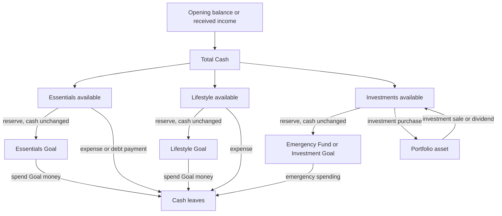
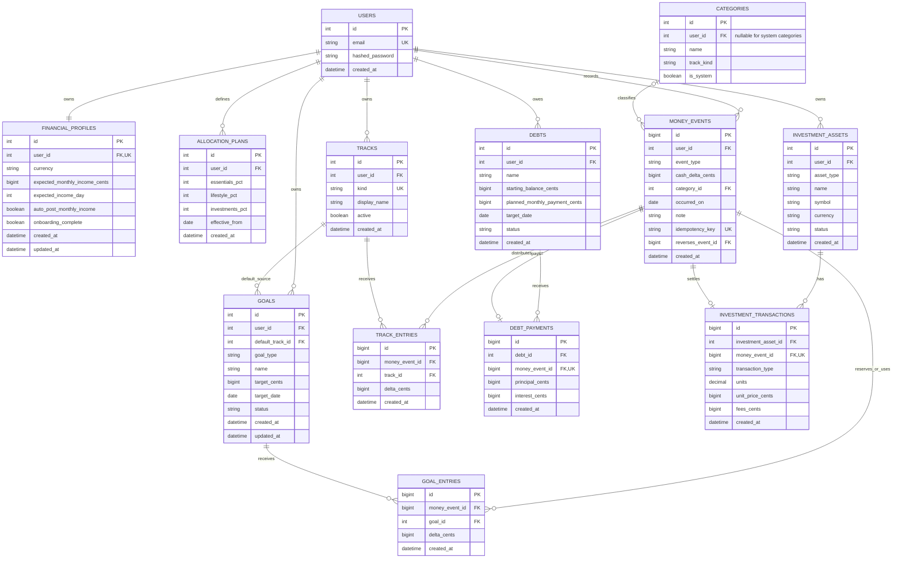

# Nisba Financial Architecture V2

Status: design proposal only. No production code or database table should be removed until this document is approved and the migration is verified.

Detailed schema companion: [DATABASE_DESIGN_V2.md](./DATABASE_DESIGN_V2.md)

## 1. Product rule

Nisba has one authoritative cash balance:

```text
Total Cash = opening balance + cash income - cash outflows + balance adjustments
```

Emergency Fund money, Wallet money and track money are not additional money. They are different assignments of the same Total Cash.

```text
Total Cash = Spendable Track Balances + Reserved Goal Balances
```

The three user-facing tracks are:

1. Essentials
2. Lifestyle
3. Investments

Debt is not a fourth track. A debt payment is an Essentials cash outflow that also reduces a Debt's outstanding balance.

Unused money never needs to be carried over manually. It remains inside Total Cash, its Track or its Goal when a new month begins.

## 2. Important meaning of each concept

| Concept | Meaning | Changes Total Cash? |
|---|---|---:|
| Total Cash | All cash the user has told Nisba about | Source value |
| Track | Spendable cash assigned to Essentials, Lifestyle or Investments | No |
| Goal | Reserved cash such as EF, Travel or Buy a Car | No |
| Expense | Cash that actually left the user | Yes, decreases it |
| Income | Cash that actually arrived | Yes, increases it |
| Debt | Money still owed; not cash | No |
| Debt payment | Cash paid toward a debt | Yes, decreases it |
| Investment purchase | Cash converted into an investment asset | Yes, decreases cash |
| Investment sale | Investment converted back into cash | Yes, increases cash |

## 3. Money-flow diagram



### Example: Travel Wallet

Before reserving:

```text
Total Cash:          10,000 MAD
Lifestyle available: 4,000 MAD
Travel Goal:              0 MAD
```

Reserve 1,500 MAD for Travel:

```text
Total Cash:          10,000 MAD  unchanged
Lifestyle available: 2,500 MAD  decreased
Travel Goal:          1,500 MAD  increased
```

Spend 600 MAD from Travel:

```text
Total Cash:           9,400 MAD  decreased
Lifestyle available: 2,500 MAD  unchanged because it was reduced when reserved
Travel Goal:            900 MAD  decreased
```

## 4. Ledger rule

`Total Cash` must not be a number manually modified by Wallet, EF, debt and dashboard code. It is calculated from one event ledger.

Every user action creates one `money_event`. The event may also create Track entries and Goal entries inside the same database transaction.

For every event, this invariant must be true:

```text
money_event.cash_delta_cents
= sum(track_entries.delta_cents)
+ sum(goal_entries.delta_cents)
```

Examples:

```text
Income:       cash +10,000 = tracks +10,000 + goals 0
Expense:      cash    -500 = tracks    -500 + goals 0
Reserve Goal: cash       0 = tracks  -1,500 + goals +1,500
Spend Goal:   cash    -600 = tracks       0 + goals   -600
```

The backend must reject any event that does not balance.

## 5. Proposed database model



## 6. Purpose of each table

### `users`

Authentication owner. Every financial record must belong directly or indirectly to one user.

### `financial_profiles`

Stores preferences and planning defaults, not real cash. Expected monthly income is a forecast until an actual Income event is posted.

### `allocation_plans`

Stores the three percentages and their effective date. Percentages must total 100. Old plans remain for historical reporting.

### `tracks`

Creates exactly three system Tracks per user: Essentials, Lifestyle and Investments. Track balances are calculated from `track_entries`; they are never stored in another balance column.

### `money_events`

The only source of truth for Total Cash. Positive deltas add cash, negative deltas remove cash and zero-delta events only reorganize existing cash.

Recommended event types:

```text
opening_balance
income
expense
debt_payment
investment_buy
investment_sell
investment_income
goal_reserve
goal_release
goal_spend
track_transfer
goal_transfer
balance_adjustment
reversal
```

### `track_entries`

Records how an event changes the available amount inside each Track. Income normally creates three positive Track entries. Reserving money creates a negative Track entry without changing cash.

### `goals`

Replaces the separate Wallet and Emergency Fund balance systems. EF is one protected system Goal; Travel, Car and Taxes are normal Goals. Every Goal has one default source Track.

Suggested Goal types:

```text
emergency_fund
savings_goal
planned_expense
tax_reserve
```

### `goal_entries`

The Goal ledger. A Goal balance is the sum of its entries. Adding money to a Goal reserves money; spending Goal money reduces both the Goal and Total Cash.

### `categories`

Explains where money was spent. Each category belongs to one Track. System categories can be shared; custom categories belong to one user.

### `debts`

Tracks liabilities only. It does not own cash and does not create a budget Track.

### `debt_payments`

Connects a Debt reduction to exactly one Essentials `money_event`. There is no `funding_source` selector.

### `investment_assets`

Represents assets such as a stock, ETF, fund, property or other investment.

### `investment_transactions`

Tracks buys, sells, dividends and fees. A buy reduces Total Cash and the Investments Track. A sell or dividend adds cash to the Investments Track.

## 7. Required user actions

| User action | Total Cash | Track effect | Goal/debt/investment effect |
|---|---:|---|---|
| Set opening balance | Increase | Remaining cash split using the plan | Existing EF portion is reserved |
| Receive monthly income | Increase | Split by current percentages | None |
| Add extra income | Increase | Split automatically or use a chosen Track | None |
| Log Essentials expense | Decrease | Essentials decreases | Expense history added |
| Log Lifestyle expense | Decrease | Lifestyle decreases | Expense history added |
| Create Goal | No change | No change | Empty Goal created |
| Reserve money in Goal | No change | Linked Track decreases | Goal increases |
| Release Goal money | No change | Linked Track increases | Goal decreases |
| Spend from Goal | Decrease | No second decrease | Goal decreases and expense is recorded |
| Move between Tracks | No change | One decreases, one increases | None |
| Move between Goals | No change | No change | One decreases, one increases |
| Reconcile real cash balance | Increase/decrease by difference | Matching adjustment is recorded | Goals are never changed silently |
| Create Debt | No change | No change | Liability created |
| Pay Debt | Decrease | Essentials decreases | Debt remaining decreases |
| Buy investment | Decrease | Investments decreases | Portfolio holding increases |
| Sell investment | Increase | Investments increases | Portfolio holding decreases |
| Receive dividend | Increase | Investments increases | Investment income recorded |

## 8. Onboarding flow

The new onboarding asks only:

1. Expected monthly income.
2. Current Total Cash, optional. If skipped, Nisba must say `Known tracked cash`, not claim to know the user's full balance.
3. Amount of that Total Cash already reserved as Emergency Fund.
4. Essentials, Lifestyle and Investments percentages.

Validation:

```text
Emergency Fund balance <= Current Total Cash
Essentials % + Lifestyle % + Investments % = 100
```

Creation process:

1. Create the three Tracks.
2. Create the allocation plan.
3. Create the EF Goal.
4. Create one opening-balance event.
5. Put the declared EF amount into the EF Goal.
6. Split the remaining opening cash across the three Tracks.

Other savings do not need a separate field. They are already contained inside Total Cash and can later be reserved in Goals.

## 9. Wallet and EF experience

### Create Goal

Required:

- Name
- Linked Track

Optional:

- Target amount
- Target date

### Add money

The app takes the amount from the Goal's linked Track. No `this month's money`, `existing savings` or funding-source selector is shown.

### Use money

The user chooses a category and amount. Total Cash and Goal balance decrease together. The spending report knows its Track through the Goal/category.

### Release money

Moves reserved money back to the linked Track. Total Cash remains unchanged.

### Emergency Fund

EF uses the same ledger rules as every Goal. It may receive or release money, but its balance can never be edited independently from Total Cash.

## 10. Editing and deleting safely

Financial history should be immutable internally:

- `Edit` creates a reversal of the old event and a corrected replacement event.
- `Delete` creates a reversal event.
- The UI can still say Edit and Delete; the audit trail remains complete.
- Reversing an event must reverse its cash, Track, Goal, Debt and Investment effects atomically.

## 11. Month behavior

There is no manual month close and no carryover transaction.

At the start of a new month:

1. Existing Total Cash remains unchanged.
2. Existing Track balances remain unchanged.
3. Existing Goal balances remain unchanged.
4. Confirmed monthly income adds new cash and is split into the Tracks.
5. Monthly charts use transaction dates to show only that month's activity.

The app may offer a monthly review, but reviewing a month must not be required to access remaining money.

## 12. Dashboard contract

The backend should return one authoritative dashboard summary. The frontend must not reconstruct Total Cash from unrelated API responses.

Top-level dashboard numbers:

```text
Total Cash
Spendable Cash = sum of three Track balances
Reserved Cash = sum of Goal balances
Investment Market Value
Debt Remaining
Net Worth = Total Cash + Investment Market Value - Debt Remaining
```

Then show:

- Essentials available, spent this month and reserved.
- Lifestyle available, spent this month and reserved.
- Investments available, invested this month and reserved.
- Goal cards.
- Monthly income versus real cash outflows.
- Wealth Path recommendation.

## 13. Current logic to remove or replace

| Current concept | V2 decision |
|---|---|
| `available_savings_cents` | Remove; savings are part of Total Cash |
| Direct EF balance editing | Remove; EF becomes a Goal |
| Wallet `source_type` | Remove |
| Wallet `source_bucket` | Replace with Goal's linked Track |
| Debt `funding_source` | Remove; debt payments use Essentials |
| `monthly_closes` | Remove after migration |
| `surplus_allocations` | Remove after migration |
| Carryover columns and actions | Remove; balances persist naturally |
| Frontend `totalTrackedCash` formula | Replace with backend balance service |
| Separate Wallet adjustment logic | Replace with balanced Goal events |
| `savings_cents` dashboard alias | Remove |

Keep and reshape:

- Users
- Categories
- Budget/allocation percentages
- Debts and payment history
- Investment types and investment history
- Wallet names, targets, dates and transaction history

## 14. Safe rebuilding plan

### Phase 0: approve the rules

Agree on this document, the three Tracks, EF behavior, Goal actions and dashboard numbers before writing migrations.

### Phase 1: protect the current app

1. Create a database backup.
2. Create a Git baseline commit and rebuild branch.
3. Do not edit old Alembic migrations.
4. Keep the current production application working during development.

### Phase 2: add V2 beside V1

1. Add the new tables without dropping old tables.
2. Implement one `MoneyService` that creates balanced events atomically.
3. Implement one `BalanceService` for Total Cash, Tracks and Goals.
4. Add invariant and scenario tests before creating UI.

### Phase 3: migrate data safely

Historical records are useful, but the current cash balance cannot be inferred reliably because the old system may contain overlapping EF, savings, Wallet and carryover values.

Recommended cutover:

1. Import old income, expenses, debt payments and investments as historical events.
2. Import Wallets and EF as Goals.
3. Ask the user once for their real current Total Cash.
4. Create one reconciliation event so V2 matches reality.
5. Preserve old tables read-only until the result is approved.

Do not add old carryover as new cash during migration; historical income and expenses already explain that money.

### Phase 4: rebuild features

1. Onboarding
2. Income and expenses
3. Tracks
4. Goals and EF
5. Debts
6. Investments
7. Dashboard
8. Wealth Path

### Phase 5: verification

Test at least these scenarios:

1. Opening cash with an existing EF.
2. Monthly income split across three Tracks.
3. Direct expense from every Track.
4. Goal reserve, release and spending.
5. Debt payment.
6. Investment buy and sale.
7. Month changing without manual carryover.
8. Event edit and reversal.
9. Balance reconciliation.
10. Two users with completely isolated data.

Every scenario must satisfy:

```text
Total Cash = Track balances + Goal balances
```

### Phase 6: cutover and cleanup

1. Switch the frontend to V2 APIs.
2. Compare V1 and V2 reports.
3. Deploy and monitor V2.
4. Remove old routes and models only after approval.
5. Drop obsolete tables in a final new migration.

## 15. Decisions still requiring approval

Before implementation, decide:

1. Should expected monthly income be posted automatically or confirmed as received?
2. Should positive extra income always use the percentage split or allow one selected Track?
3. Should users be allowed to transfer available money between Tracks?
4. Should Goal-to-Goal transfers be visible or hidden initially?
5. When reconciliation finds missing cash, should Nisba deduct proportionally from Tracks or ask the user where it came from?
6. Should Investment Market Value be entered manually first, then connected to market data later?

The recommended simple defaults are: confirm monthly income, split extra income automatically, allow Track transfers, hide Goal-to-Goal transfers initially, ask before deducting missing cash and support manual investment valuation first.
